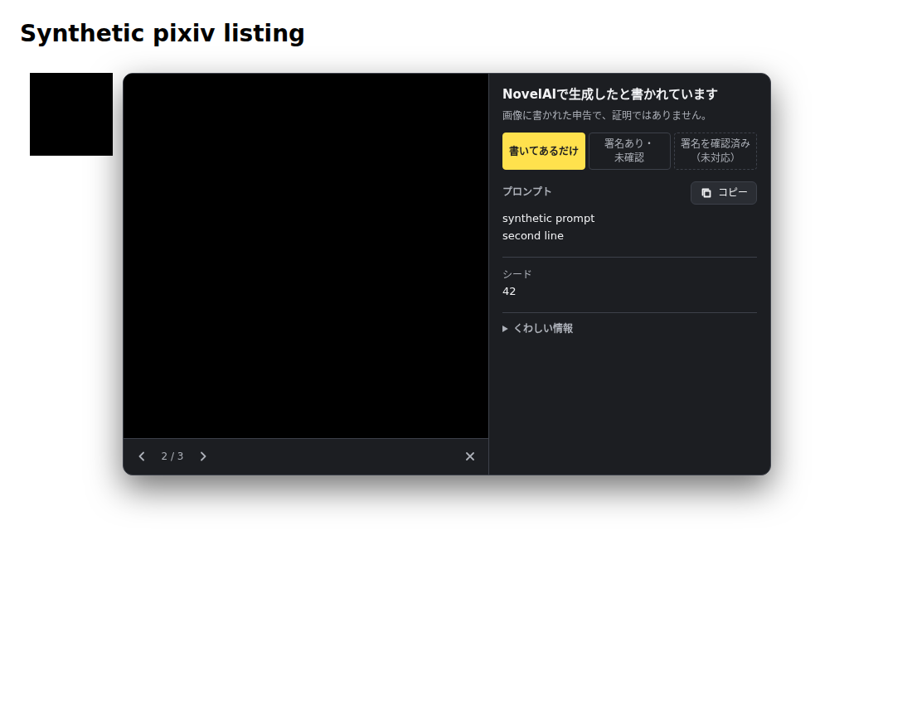

# Pixiv-Metatan

pixivのサムネイルにカーソルを合わせると作品をプレビューでき、ボタンを押すと画像に埋め込まれたAI生成情報（プロンプトや生成設定）を読み取れる、Chrome / Edge 用の拡張機能です。名前の「メタ探」は「メタデータ探偵」から取りました。

pixiv公式のツールではなく、ピクシブ株式会社とは関係ありません。



> 開発中の版です。動作は用意したテストデータで確認していますが、実際のpixivの画面での確認はまだ途中です。詳しくは[検証状況](docs/TEST_STATUS.md)をご覧ください。

## できること

- 検索結果やランキング、ブックマークなどの一覧でサムネイルにカーソルを合わせると、大きめのプレビューが開きます。複数枚の作品はページをめくれます。
- プレビューの「生成情報を見る」を押すと、表示中のページの原寸画像を1枚だけ読み込み、画像の横に結果を出します。最初に「何で生成したと書かれているか」を一文で示し、その下にプロンプトやシード、サンプラーなどの設定を並べます。
- 手元の画像も調べられます。拡張機能のアイコンを押すと検査ページが開くので、画像をドロップするか選択してください。複数の画像をまとめて入れられ、1枚ずつ順に読みます（一覧に入るのは20枚まで）。

読み取れる形式は次のとおりです。

- NovelAI: PNGのテキスト情報、アルファチャンネルに埋め込まれた情報（Stealth形式）、V4のキャラクター別プロンプト
- ComfyUI: PNGのprompt / workflow、WebPのEXIF
- AUTOMATIC1111 / Forge: PNGのparameters、JPEG / WebPのEXIF

ComfyUIの情報は、ノードのデータをそのまま折りたたんで表示します。どれがプロンプトかの推測はしません。

## 結果の読み方

画像に埋め込まれた生成情報は、誰でも書き換えたり消したりできます。表示されるのは「メタデータにこう書いてある」という内容で、どのツールで作られたかの証明にはなりません。

結果の一文の下にある3段階の目盛りは、その申告をどこまで信じてよいかを示します。今の版で出るのは「書いてあるだけ」か「署名あり・未確認」までです。NovelAIの電子署名の検証にはまだ対応していないので、「署名を確認済み」にはなりません。

反対に、情報が見つからなくても、人が描いた絵だとは限りません。画像の変換や投稿サービスの処理で、情報が消えることはよくあります。

## インストール

まだストアには出していないので、ソースからビルドして読み込みます。Node.js は 22.22.2 以降の22系、24.15 以降の24系、または26以降を使ってください。

```bash
npm ci
npm run build        # Chrome用。.output/chrome-mv3/ にできます
npm run build:edge   # Edge用。.output/edge-mv3/ にできます
```

1. Chromeは `chrome://extensions`、Edgeは `edge://extensions` を開き、デベロッパーモードをオンにします。
2. 「パッケージ化されていない拡張機能を読み込む」から、上の出力フォルダを選びます。
3. 開いているpixivのタブを再読み込みします。

## 使い方

- サムネイルの上に0.25秒ほどカーソルを置くとプレビューが開き、離れると閉じます。キーボードでは、作品リンクにフォーカスして↓キーでプレビューに移れます。
- 複数枚の作品は、プレビューの上でホイールを回すか、前後ボタンや左右キーでページを切り替えます。
- 「生成情報を見る」を押すと、画像の横（画面が狭いときは下）に結果が出ます。押したあとはカーソルを離しても閉じません。×ボタン、Escキー、プレビューの外のクリックで閉じます。
- プロンプトは見出し横の「コピー」でコピーできます。根拠や生データ、結果全体のコピーは「くわしい情報」の中にあります。
- 原寸を読み込めなかったときは、「手元の画像で調べる」から保存済みの画像を選べます。選んだファイルが表示中の作品と同じかどうかは確かめません。
- 作品ページでは、右下の「生成情報」ボタンから、その作品を同じプレビューで開けます。

## 注意点

- pixivの画像サーバーは、pixivからのアクセスであることを示す `Referer` がないと原寸画像を返しません。そのためこの拡張は、自分で読み込む原寸画像にだけ `Referer: https://www.pixiv.net/` を付けます。Cookieは送らず、pixivのページや他のサイトの通信には手を加えません。
- 作品のページ情報は、pixivの公開されていないAPI（`/ajax/illust/{id}/pages`）から取っています。pixiv側の仕様が変わると動かなくなることがあります。
- GIFやうごイラは、プレビューだけで生成情報は読みません。
- 48 MiBを超えるファイル、4,000万画素を超える画像、壊れたデータは、途中で読み込みをやめます。通信は15秒で打ち切ります。
- まだ対応していないもの: NovelAIの署名の検証、XMP / IPTC、16ビットやインターレースのPNGのStealth形式。APNGはテキスト情報だけを読み、アニメーションのフレームは調べません。
- 画面の表示は日本語だけです。表示はpixivのライト / ダークどちらでも、暗い色の1種類です。

## プライバシー

通信するのはpixivとpixivの画像サーバー（i.pximg.net）だけです。画像やプロンプトを外部に送ったり、ディスクに保存したりはしません。読み取った結果は、そのタブのメモリに最大2分だけ置いておきます。

一覧の自動巡回、原寸の先読み、一括ダウンロード、自動の再試行はしません。原寸の読み込みは、すべてのタブを合わせて同時に1件までです。詳しくは[プライバシー](docs/PRIVACY.md)をご覧ください。

## 開発

```bash
npm run typecheck
npm test                 # 単体テスト
npm run check:manifest   # 権限が増えていないかの確認（ビルド後に実行）
npm run test:browser     # ブラウザでのUIテスト
npm run test:extension   # ビルドした拡張を読み込んだテスト
```

ブラウザを使うテストの前に `npx playwright install --with-deps chromium` を実行してください。手元のChromeを使うときは `METATAN_CHROME_PATH` にパスを指定します。テストはすべて用意したページと画像で行い、実際のpixivにはつなぎません。テスト画像はすべてこのリポジトリで作った合成画像です。

- 設計: [docs/ARCHITECTURE.md](docs/ARCHITECTURE.md)
- 検証状況: [docs/TEST_STATUS.md](docs/TEST_STATUS.md)
- 実際のpixivでの確認手順: [docs/MANUAL_TESTS.md](docs/MANUAL_TESTS.md)
- 残っている作業: [docs/IMPLEMENTATION_PLAN.md](docs/IMPLEMENTATION_PLAN.md)
- 変更履歴: [CHANGELOG.md](CHANGELOG.md)

IssueやPull Requestを歓迎します。守ってほしい決まり（原寸画像はユーザーが押したときにしか読み込まない、権限を増やさない、など）は[AGENTS.md](AGENTS.md)にまとめています。他の人の作品画像やCookieなどは、IssueやPull Requestに貼らないでください。脆弱性は公開のIssueではなく、[SECURITY.md](SECURITY.md)の方法で知らせてください。

## ライセンス

MITライセンスです。同梱している他のプロジェクトのコードと、参考にしたプロジェクトについては[THIRD_PARTY_NOTICES.md](THIRD_PARTY_NOTICES.md)に書いています。pixivはピクシブ株式会社の商標です。

## English

Pixiv-Metatan ("metadata detective") is an unofficial Chrome/Edge extension for pixiv. Hover over a thumbnail to preview the artwork, then press **生成情報を見る** ("show generation info") to read the AI generation info embedded in the original image (NovelAI, ComfyUI, AUTOMATIC1111/Forge). The result opens beside the image and starts with one sentence saying what the image claims. You can also drop local images onto the inspector page that opens from the toolbar icon.

Everything runs on your machine. Nothing is uploaded or stored, and there is no telemetry. To fetch an original, the extension adds `Referer: https://www.pixiv.net/` to that one request, because pixiv's image server requires it. It doesn't send cookies or touch any other traffic.

Embedded metadata is self-reported and easy to edit, so treat the results as hints, not proof. Missing metadata doesn't mean a person drew the image. NovelAI signatures are not verified yet.

The extension isn't in any store yet. Build it with `npm ci && npm run build` and load `.output/chrome-mv3/` as an unpacked extension. The UI is in Japanese only. MIT licensed. Not affiliated with pixiv Inc.
